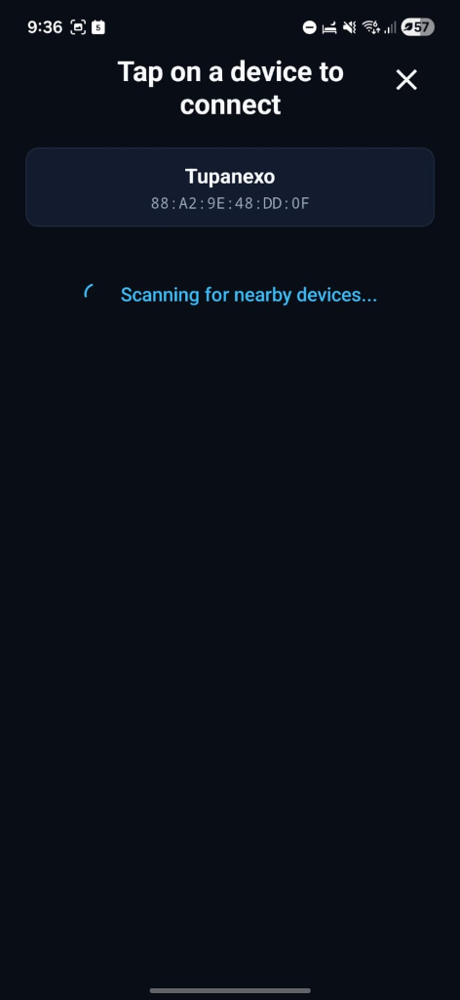
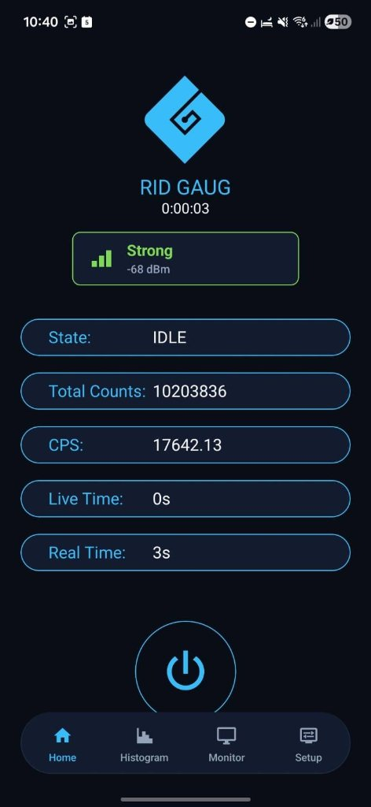
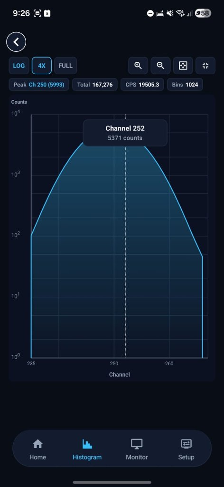
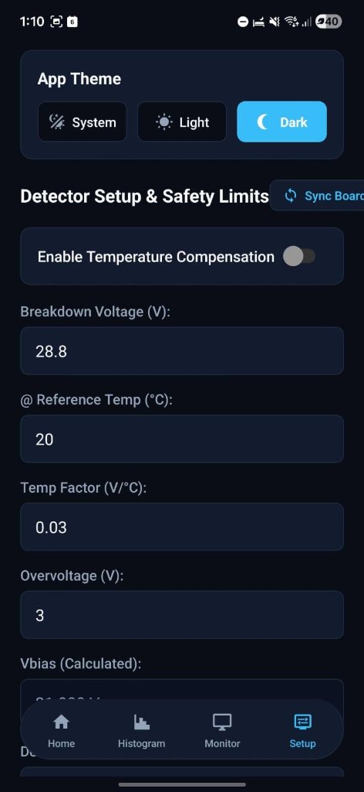

**Gaugit** (**RID GAUG**) is a React Native mobile application developed during my Scientific Initiation at **IPEN** (Butantã, São Paulo) to interface with the **OpenDosimeter** embedded firmware over **Bluetooth Low Energy (BLE)**.

> **Recognition:** Project awarded at the **10th IPEN Technological Innovation Award** (*X Prêmio de Inovação Tecnológica do IPEN*).

## Overview

The application bridges portable radiation detection hardware and mobile visualization, allowing researchers and operators to pair with nearby detector boards, monitor live radiation counts and count rates (CPS), inspect 4096-channel energy spectra in real time, and configure bias voltage and temperature compensation parameters directly from a smartphone.

Generative AI tooling (**OpenAI Codex** and **Google Antigravity**) was integrated into the development workflow to accelerate feature implementation, code optimization, and debugging alongside Git version control.

## Key Features & Screens

### 1. BLE Device Discovery & Pairing
Scans for nearby BLE peripherals and lists detected hardware with device name and MAC address (e.g., `Tupanexo`) for quick tap-to-connect pairing.

### 2. Real-Time Telemetry Dashboard (`RID GAUG`)
Displays live connection health and RSSI signal strength (`-68 dBm`), elapsed session timer, operational state (`IDLE` / active acquisition), **Total Counts**, **CPS** (Counts Per Second), **Live Time**, **Real Time**, and a central acquisition toggle button.

### 3. Interactive Energy Spectrum Histogram
Renders a real-time **4096-bin** radiation energy histogram with logarithmic (`LOG`), `4X`, and `FULL` view presets, zoom/pan controls, summary metrics (`Peak Ch`, `Total`, `CPS`, `Bins`), and interactive channel inspection tooltips.

### 4. Detector Setup & Safety Limits
Provides on-device calibration and hardware synchronization (`Sync Board`), including **Temperature Compensation** toggle, **Breakdown Voltage (V)**, **Reference Temp (°C)**, **Temp Factor (V/°C)**, **Overvoltage (V)**, calculated **Vbias**, and **System / Light / Dark** theme selection.

## Technical Highlights

- **Cross-Platform Mobile UI**: Built with **React Native** featuring a dark-first telemetry design and 4-tab navigation (`Home`, `Histogram`, `Monitor`, `Setup`).
- **BLE Hardware Integration**: Real-time bidirectional communication with embedded **OpenDosimeter** firmware for streaming radiation counts, spectrum bins, and syncing detector safety parameters.
- **High-Density Data Visualization**: Responsive logarithmic spectrum plotting across 4096 channels with interactive peak/channel inspection.
