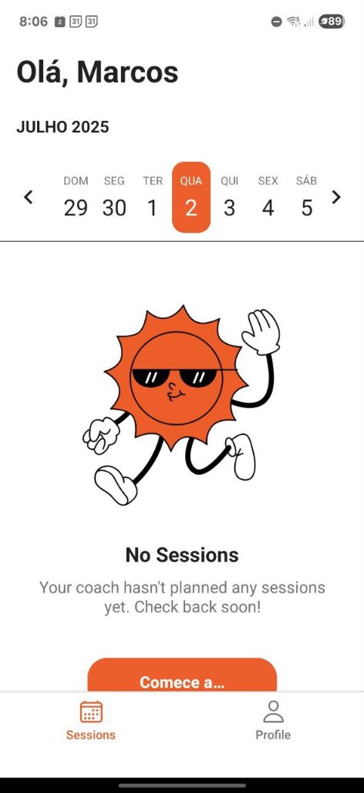

**Zyla** is a mobile running and coaching application where I worked as a **Mobile Developer** (Jan 2025 – Sep 2025), building the app in **React Native** and designing and structuring its interface screens in **Figma**.

## Overview

The app gives athletes a clear weekly calendar view of training sessions prescribed by their coach, highlighting workout types, training cycle phases, target duration, distance, and rest days in a clean, warm-toned mobile interface.

## Key Features & Screens

### 1. Weekly Workout Feed & Training Cards
Displays a horizontal week strip calendar (`DOM`–`SÁB`) paired with daily workout cards detailing session type (e.g., *Rodagem + Strides*, *Descanso*, *Regenerativo*), training block progress (*Fase de Base - Semana 1/3*), duration (`35 min`), and distance (`5.4 km`), with quick bottom navigation between **Treinos** and **Perfil**.

### 2. Calendar Selection & Illustrated Empty State
Provides an interactive date selector with active-day highlighting and a friendly custom-illustrated empty state (*"No Sessions — Your coach hasn't planned any sessions yet. Check back soon!"*) with a primary action button.

## My Contributions

- **Mobile Engineering**: Implemented application screens, navigation flows, and reusable UI components in **React Native** with **Git** version control.
- **UI/UX Design**: Designed and structured the visual hierarchy, calendar layout, workout cards, and empty-state experience in **Figma**.
