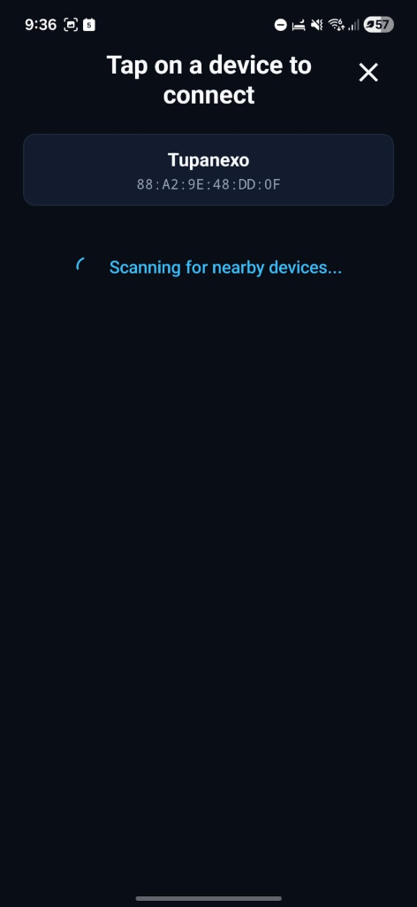
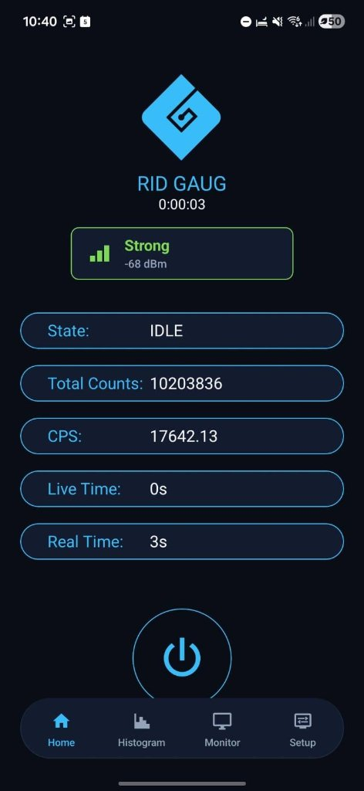
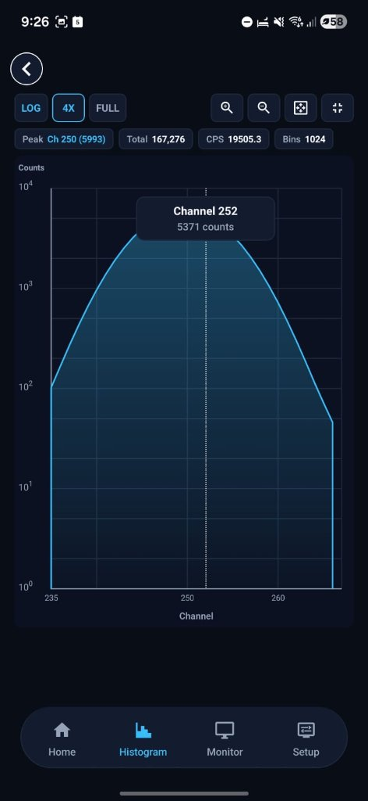
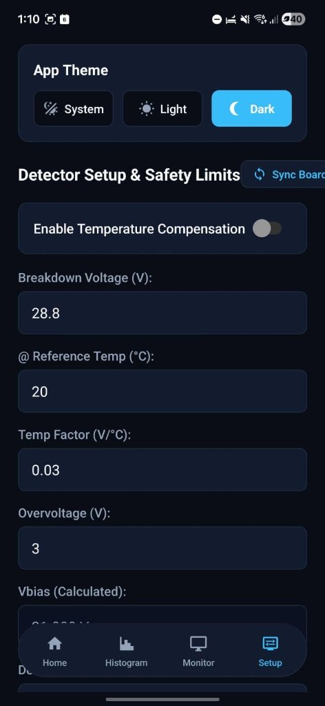

O **Gaugit** (**RID GAUG**) é um aplicativo mobile em **React Native** desenvolvido na minha Iniciação Científica no **IPEN** (Butantã, São Paulo) para comunicação em tempo real com o firmware embarcado do **OpenDosimeter** via **Bluetooth Low Energy (BLE)**.

> **Reconhecimento:** Projeto premiado no **X Prêmio de Inovação Tecnológica do IPEN**.

## Visão Geral

O aplicativo conecta o hardware portátil de detecção de radiação ao smartphone, permitindo parear rapidamente com placas próximas, acompanhar contagens totais e taxas de contagem (CPS) em tempo real, inspecionar espectros de energia de 4096 canais e sincronizar parâmetros de segurança e compensação térmica diretamente com o detector.

O desenvolvimento contou com apoio de ferramentas de IA generativa (**OpenAI Codex** e **Google Antigravity**) para implementação, otimização e depuração de código, com versionamento em **Git**.

## Funcionalidades e Telas

### 1. Descoberta e Pareamento via BLE
Varredura de dispositivos BLE próximos exibindo nome e endereço MAC (como `Tupanexo`) para conexão direta com um toque.

### 2. Painel de Telemetria em Tempo Real (`RID GAUG`)
Exibe força de sinal BLE (`Strong` / `-68 dBm`), cronômetro da sessão, estado do equipamento (`IDLE`), **Total Counts**, **CPS** (contagens por segundo), **Live Time**, **Real Time** e botão central para iniciar/pausar a aquisição.

### 3. Histograma Interativo de Espectro de Energia
Visualização em tempo real com **4096 bins**, modos de escala e zoom (`LOG`, `4X`, `FULL`), métricas resumidas (`Peak Ch`, `Total`, `CPS`, `Bins`) e tooltip interativo para inspeção de cada canal.

### 4. Configuração do Detector e Limites de Segurança
Ajuste de parâmetros enviados ao hardware (`Sync Board`), incluindo ativação de **Compensação de Temperatura**, **Breakdown Voltage (V)**, **Temperatura de Referência (°C)**, **Temp Factor (V/°C)**, **Overvoltage (V)**, cálculo de **Vbias** e seletor de tema (**System / Light / Dark**).

## Destaques Técnicos

- **Interface Mobile**: Construída em **React Native** com foco em legibilidade em campo e navegação em 4 abas (`Home`, `Histogram`, `Monitor`, `Setup`).
- **Comunicação BLE com Firmware**: Transmissão contínua de dados de radiação e sincronização bidirecional de parâmetros de operação com o **OpenDosimeter**.
- **Visualização Científica**: Plotagem logarítmica responsiva de 4096 canais com seleção interativa de picos e contagens.
