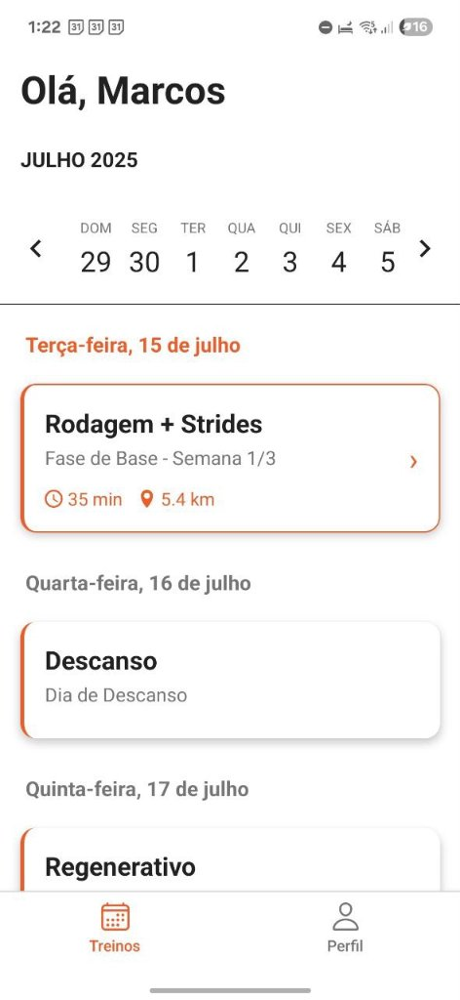
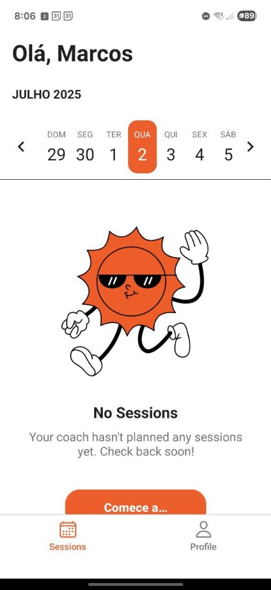

O **Zyla** é um aplicativo mobile voltado para treinos de corrida e acompanhamento por treinador, no qual atuei como **Mobile Developer** (Jan 2025 – Set 2025), realizando o desenvolvimento em **React Native** e o design e estruturação das telas no **Figma**.

## Visão Geral

O aplicativo oferece ao atleta uma visão clara e semanal dos treinos prescritos pelo treinador, destacando o tipo de sessão, fase do ciclo de treinamento, duração, distância e dias de descanso em uma interface limpa e acolhedora.

## Funcionalidades e Telas

### 1. Agenda Semanal e Cards de Treino
Exibe calendário semanal interativo (`DOM`–`SÁB`) combinado com cards diários detalhando o treino (como *Rodagem + Strides*, *Descanso*, *Regenerativo*), fase do treinamento (*Fase de Base - Semana 1/3*), duração (`35 min`) e distância (`5.4 km`), com navegação inferior entre **Treinos** e **Perfil**.

### 2. Seleção de Datas e Empty State Ilustrado
Inclui destaque visual para o dia selecionado no calendário semanal e um estado vazio ilustrado (*"No Sessions — Your coach hasn't planned any sessions yet. Check back soon!"*) acompanhado de botão de ação principal.

## Minhas Contribuições

- **Desenvolvimento Mobile**: Implementação das telas, fluxos de navegação e componentes reutilizáveis em **React Native**, utilizando **Git** para controle de versão.
- **Design e Estruturação (UI/UX)**: Prototipação e organização da hierarquia visual, calendário semanal, cards de treino e telas de estado vazio no **Figma**.
